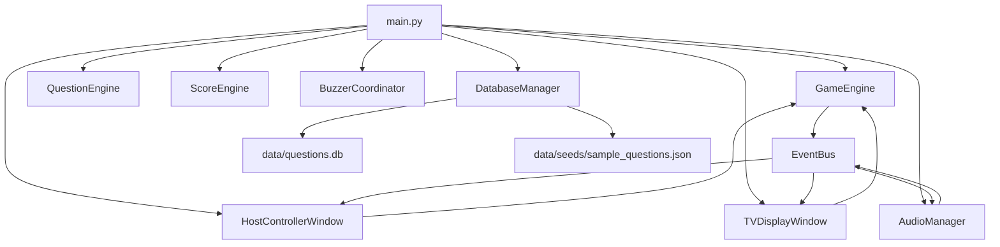

# Project Guide

Tài liệu này mô tả cấu trúc hiện tại của dự án sau khi dọn các file rác phát sinh từ backup, cache và script tạm thời. Ứng dụng vẫn là game show Jeopardy! đa màn hình chạy bằng Python + PySide6, với hai cửa sổ chính:

- HostControllerWindow: giao diện điều khiển cho MC/host
- TVDisplayWindow: màn hình hiển thị cho khán giả/thí sinh

## Kết quả dọn sạch

Các file rác đã được loại bỏ khỏi workspace, bao gồm:

- `__pycache__` và file `.pyc` / `.pyo`
- file backup `.bak`
- file cache tạm thời và output render không phải source chính

Source chính còn lại tập trung ở:

- `main.py`
- `core/`
- `ui/`
- `data/`
- `locales/`
- `network/`

---

## Kiến trúc tổng quan



---

## Cấu trúc file chính

### 1) Entry point

- `main.py`
  - tạo `QApplication`
  - cấu hình OpenGL / DPI
  - khởi tạo SQLite qua `DatabaseManager`
  - khởi tạo `QuestionEngine`, `ScoreEngine`, `BuzzerCoordinator`, `GameEngine`
  - tạo `AudioManager`, `HostControllerWindow`, `TVDisplayWindow`

### 2) Core logic

- `core/engine.py`
  - `GameEngine`: FSM quản lý vòng chơi, phase chuyển đổi, Final Jeopardy, tiebreaker
- `core/questions.py`
  - `QuestionEngine`: quản lý board, clue, round, category, trạng thái đã dùng
- `core/scoring.py`
  - `ScoreEngine`: điểm số, wager, phrasing validation, history undo
- `core/buzzer.py`
  - `BuzzerCoordinator`: lockout buzzer và timeout logic
- `core/event_bus.py`
  - `EventBus`: trung tâm tín hiệu của UI và logic game

### 3) UI

- `ui/host_controller.py`
  - giao diện host chính, tab board, final jeopardy, quản lý điểm và timer
- `ui/tv_display.py`
  - màn hình TV, board, clue, category reveal, daily double, final screen
- `ui/audio_manager.py`
  - singleton âm thanh, nhận event từ `event_bus.play_sound_event`, phát SFX và music nền
- `ui/theme_manager.py`
  - quản lý theme và XML config
- `ui/settings_dialog.py`
  - dialog cài đặt theme, font, animation, âm thanh

### 4) Data layer

- `data/db.py`
  - khởi tạo schema SQLite và seed dữ liệu mẫu
- `data/history.py`
  - lưu lịch sử trận đấu, thống kê, winner record
- `data/models.py`
  - model dữ liệu cho round, category, clue, player
- `data/questions.db`
  - database runtime của project
- `data/seeds/sample_questions.json`
  - dữ liệu seed ban đầu

### 5) Locales

- `locales/en.json`
- `locales/vi.json`

### 6) Network placeholders

- `network/architecture.md`
- `network/readme_network.md`

Hiện tại, network chưa là phần chạy chính của ứng dụng.

---

## Luồng hoạt động chính

1. `main.py` khởi tạo app và database.
2. `GameEngine` điều khiển vòng chơi thông qua `QuestionEngine` và `ScoreEngine`.
3. HostController gửi lệnh chọn clue / xử lý điểm / bật timer.
4. TVDisplay hiển thị board, category reveal, clue, daily double, final clue.
5. `EventBus` là cầu nối: UI, audio, board, scoring và final reveal đều tương tác qua signal.
6. `AudioManager` lắng nghe `event_bus.play_sound_event` để phát âm thanh tương ứng.

---

## Hướng dẫn chạy

### Cài đặt

```bash
python -m venv venv
venv\Scripts\activate
pip install -r requirements.txt
```

### Chạy app

```bash
python main.py
```

### Lưu ý khi chạy

- nên mở trên máy có PySide6 tương thích
- nếu có 2 màn hình, TV display thường nên mở trên screen thứ hai
- database sẽ tự khởi tạo nếu file `data/questions.db` chưa có dữ liệu

---

## Mục tiêu của từng thành phần

- `EventBus`: kết nối logic và giao diện mà không cần acopling trực tiếp
- `QuestionEngine`: kiểm soát clue và round
- `ScoreEngine`: hiển thị / cập nhật điểm và validate wager
- `AudioManager`: phát sound sự kiện, không phát trùng vì dùng singleton
- `TVDisplayWindow`: render mọi trạng thái màn hình board / clue / final
- `HostControllerWindow`: điều khiển và xử lý input host

---

## Ghi chú cleanup

Dự án hiện đang ở trạng thái source-clean: không còn backup cũ, cache, hoặc file rác trong thư mục làm việc. Nếu bạn cần tiếp tục cleanup, nên ưu tiên giữ nguyên các file dưới `core/`, `ui/`, `data/` và `locales/` vì đây là phần logic thực sự của ứng dụng.

Nội dung âm thanh được mô tả chi tiết trong [AUDIO_TRIGGERS_GUIDE.md](AUDIO_TRIGGERS_GUIDE.md).

