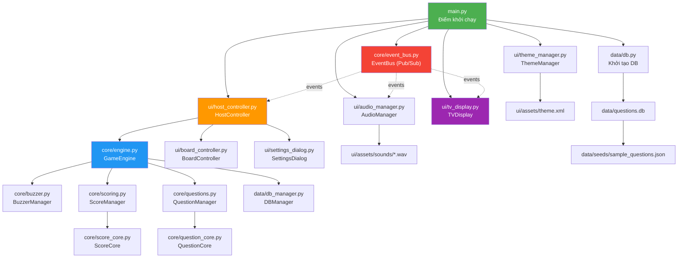
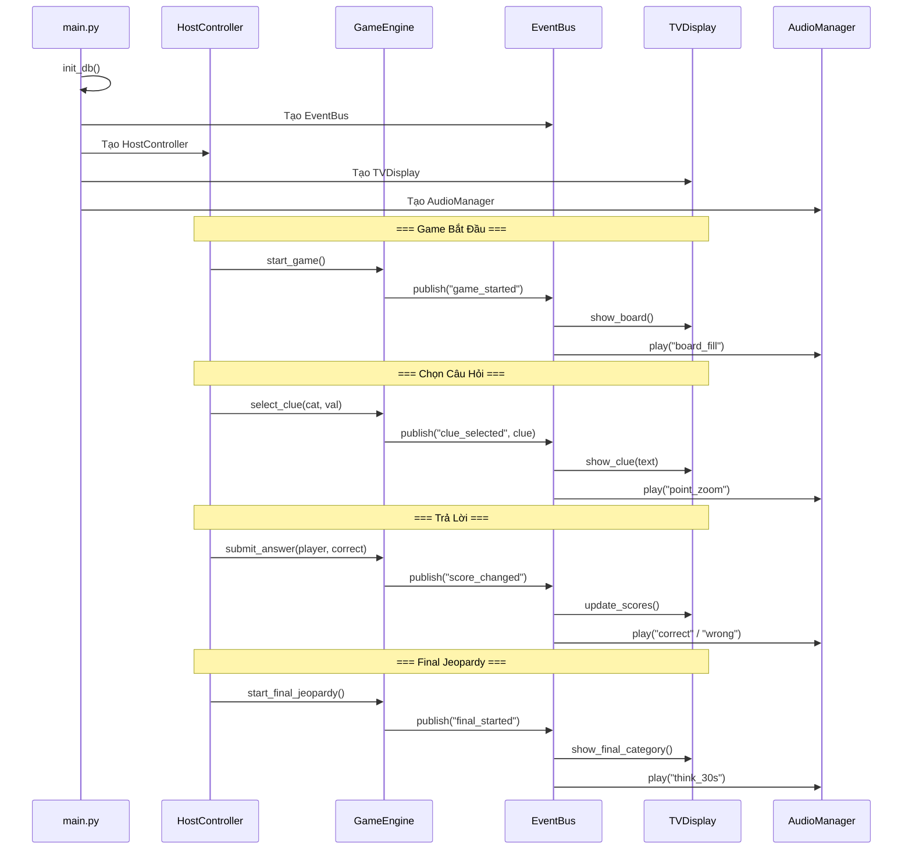
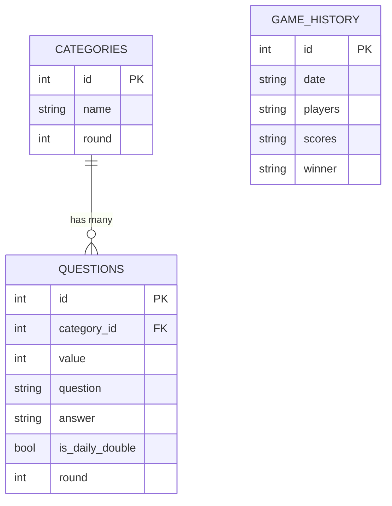

# 📘 Hướng Dẫn Dự Án Open-J (Jeopardy! Game Show)

> **Open-J** là ứng dụng mô phỏng game show **Jeopardy!** viết bằng Python + PySide6 (Qt).  
> Ứng dụng gồm 2 cửa sổ: **Host Controller** (cho MC điều khiển) và **TV Display** (cho thí sinh/khán giả xem).

---

## 📐 Kiến Trúc Tổng Quan



---

## 📁 Phân Nhóm File Theo Chức Năng

### 🟢 Nhóm 1: Điểm Khởi Chạy (Entry Point)

| File | Chức năng |
|------|-----------|
| [`main.py`](file:///c:/Users/Admin/Downloads/Project_Open-J/main.py) | Điểm khởi chạy ứng dụng. Tạo `QApplication`, khởi tạo DB, tạo `EventBus`, khởi tạo `ThemeManager`, `AudioManager`, `HostController`, `TVDisplay` và kết nối chúng lại với nhau |
| [`requirements.txt`](file:///c:/Users/Admin/Downloads/Project_Open-J/requirements.txt) | Danh sách thư viện cần cài: `PySide6`, `numpy` |

---

### 🔵 Nhóm 2: Core Logic — Bộ Máy Game (`core/`)

| File | Class chính | Chức năng |
|------|-------------|-----------|
| [`core/engine.py`](file:///c:/Users/Admin/Downloads/Project_Open-J/core/engine.py) | `GameEngine` | **Trung tâm logic** — Điều phối toàn bộ luồng chơi: quản lý vòng chơi (Round 1, Double Jeopardy, Final), load câu hỏi, xử lý chọn clue, Daily Double, đặt cược, trả lời đúng/sai, chuyển vòng tự động |
| [`core/buzzer.py`](file:///c:/Users/Admin/Downloads/Project_Open-J/core/buzzer.py) | `BuzzerManager` | Quản lý hệ thống chuông bấm: `arm()`, `disarm()`, `buzz(player_id)`, chỉ người bấm đầu tiên mới thắng (lock-out) |
| [`core/scoring.py`](file:///c:/Users/Admin/Downloads/Project_Open-J/core/scoring.py) | `ScoreManager` | Quản lý điểm tích hợp EventBus: thêm/trừ điểm, phát event `score_changed`, hỗ trợ undo |
| [`core/score_core.py`](file:///c:/Users/Admin/Downloads/Project_Open-J/core/score_core.py) | `ScoreCore` | Logic tính điểm thuần: cộng/trừ điểm, validate wager, tìm người dẫn đầu |
| [`core/questions.py`](file:///c:/Users/Admin/Downloads/Project_Open-J/core/questions.py) | `QuestionManager` | Load câu hỏi từ DB cho từng round (6 categories × 5 values), lấy clue, load Final Jeopardy |
| [`core/question_core.py`](file:///c:/Users/Admin/Downloads/Project_Open-J/core/question_core.py) | `QuestionCore` | Logic câu hỏi thuần: validate format, tạo board layout, chọn ô Daily Double ngẫu nhiên |
| [`core/event_bus.py`](file:///c:/Users/Admin/Downloads/Project_Open-J/core/event_bus.py) | `EventBus` | **Hệ thống Pub/Sub** tích hợp Qt (QObject) — Kênh giao tiếp chung giữa tất cả module. Thread-safe (QMutex), hỗ trợ wildcard |
| [`core/core_eventbus.py`](file:///c:/Users/Admin/Downloads/Project_Open-J/core/core_eventbus.py) | `CoreEventBus` | Phiên bản event bus đơn giản (không Qt), có thể là bản draft/fallback |
| [`core/i18n.py`](file:///c:/Users/Admin/Downloads/Project_Open-J/core/i18n.py) | `I18n` | Hệ thống đa ngôn ngữ (singleton): load file JSON từ `locales/`, hàm `t(key)` để dịch, mặc định tiếng Việt |

---

### 🟠 Nhóm 3: Giao Diện Người Dùng (`ui/`)

| File | Class chính | Chức năng |
|------|-------------|-----------|
| [`ui/host_controller.py`](file:///c:/Users/Admin/Downloads/Project_Open-J/ui/host_controller.py) | `HostController` | ⭐ **Cửa sổ điều khiển chính** cho MC/Host. Gồm nhiều tab: |
| | | • **Tab 1 (Dashboard)**: Hiển thị điểm 3 thí sinh, nút Start/Reveal/Correct/Wrong, panel Daily Double |
| | | • **Tab 2 (Game Board)**: Nhúng `BoardController` để chọn câu hỏi |
| | | • **Tab 3 (Final Jeopardy)**: Nhập wager, reveal đáp án từng người |
| | | • **Tab Settings**: Mở `SettingsDialog` |
| [`ui/tv_display.py`](file:///c:/Users/Admin/Downloads/Project_Open-J/ui/tv_display.py) | `TVDisplay` | ⭐ **Màn hình TV** toàn màn hình cho thí sinh/khán giả. Các trạng thái: Standby, Board, Clue, Answer, Daily Double splash, Final Jeopardy, Category Reveal animation, Point Zoom |
| [`ui/board_controller.py`](file:///c:/Users/Admin/Downloads/Project_Open-J/ui/board_controller.py) | `BoardController` | Widget bảng game 6×5 trên Host Controller (Tab 2). Mỗi ô là nút bấm, highlight Daily Double, disable ô đã chọn |
| [`ui/audio_manager.py`](file:///c:/Users/Admin/Downloads/Project_Open-J/ui/audio_manager.py) | `AudioManager` | Quản lý phát âm thanh: SFX (correct, wrong, daily_double...), nhạc nền, fade out. Tự động phát khi nhận event từ EventBus |
| [`ui/theme_manager.py`](file:///c:/Users/Admin/Downloads/Project_Open-J/ui/theme_manager.py) | `ThemeManager` | Quản lý theme/stylesheet: load từ XML, áp dụng màu sắc/font Jeopardy! classic (xanh dương đậm, font ITC Korinna) |
| [`ui/settings_dialog.py`](file:///c:/Users/Admin/Downloads/Project_Open-J/ui/settings_dialog.py) | `SettingsDialog` | Dialog cài đặt: tên thí sinh, âm lượng, theme, ngôn ngữ, số round, timer, cho phép điểm âm |

---

### 🟣 Nhóm 4: Dữ Liệu & Database (`data/`)

| File | Class/Function chính | Chức năng |
|------|---------------------|-----------|
| [`data/db.py`](file:///c:/Users/Admin/Downloads/Project_Open-J/data/db.py) | `init_db()` | Khởi tạo SQLite DB: tạo bảng `categories`, `questions`, `game_history`. Seed dữ liệu mẫu nếu DB rỗng |
| [`data/db_manager.py`](file:///c:/Users/Admin/Downloads/Project_Open-J/data/db_manager.py) | `DBManager` | Truy vấn DB: lấy categories, questions theo round, CRUD câu hỏi, lưu lịch sử game |
| [`data/models.py`](file:///c:/Users/Admin/Downloads/Project_Open-J/data/models.py) | `Category`, `Question`, `Player`, `GameState`, `GameResult` | Các dataclass đại diện cho dữ liệu: Category, Question, Player, GameState, GameResult |
| [`data/history.py`](file:///c:/Users/Admin/Downloads/Project_Open-J/data/history.py) | `GameHistory` | Lưu/truy vấn lịch sử game: save kết quả, get history, thống kê win rate |
| [`data/seeds/sample_questions.json`](file:///c:/Users/Admin/Downloads/Project_Open-J/data/seeds/sample_questions.json) | — | Bộ câu hỏi mẫu để seed vào DB (Round 1 + Round 2 + Final Jeopardy) |
| `data/questions.db` | — | File SQLite database chứa câu hỏi và lịch sử (tự động tạo) |

---

### 🟡 Nhóm 5: Tài Nguyên (Assets)

| File/Thư mục | Chức năng |
|--------------|-----------|
| [`ui/assets/theme.xml`](file:///c:/Users/Admin/Downloads/Project_Open-J/ui/assets/theme.xml) | Cấu hình theme: bảng màu Jeopardy! (board_bg, clue_text, value_text...), font (ITC Korinna, Swiss 911) |
| `ui/assets/sounds/` | Hiệu ứng âm thanh: `correct.wav`, `wrong.wav`, `daily_double.wav`, `timeout.wav`, `think_30s.wav`, `board_fill.mp3`, v.v. |
| `ui/assets/image/` | Hình ảnh: `jeopardy_logo.png`, `daily_double.png`, `clue_blue.png`, `clue_red.png`, `final_blue.png`, `standby_mosaic_wallpaper.png`, v.v. |
| [`ui/assets/make_logo.py`](file:///c:/Users/Admin/Downloads/Project_Open-J/ui/assets/make_logo.py) | Script tạo logo/hình ảnh tự động |

---

### 🌐 Nhóm 6: Đa Ngôn Ngữ (Localization)

| File | Chức năng |
|------|-----------|
| [`locales/en.json`](file:///c:/Users/Admin/Downloads/Project_Open-J/locales/en.json) | Bản dịch tiếng Anh (game labels, host buttons, settings) |
| [`locales/vi.json`](file:///c:/Users/Admin/Downloads/Project_Open-J/locales/vi.json) | Bản dịch tiếng Việt (mặc định) |

---

### 📝 Nhóm 7: Tài Liệu (Documentation)

| File | Nội dung |
|------|----------|
| [`core/readme_core.md`](file:///c:/Users/Admin/Downloads/Project_Open-J/core/readme_core.md) | Tài liệu module Core |
| [`ui/readme_ui.md`](file:///c:/Users/Admin/Downloads/Project_Open-J/ui/readme_ui.md) | Tài liệu module UI |
| [`data/readme_data.md`](file:///c:/Users/Admin/Downloads/Project_Open-J/data/readme_data.md) | Tài liệu module Data |
| [`network/readme_network.md`](file:///c:/Users/Admin/Downloads/Project_Open-J/network/readme_network.md) | Tài liệu module Network (chưa triển khai) |
| [`network/architecture.md`](file:///c:/Users/Admin/Downloads/Project_Open-J/network/architecture.md) | Kiến trúc mạng (dự kiến) |

---

### 🔧 Nhóm 8: Scripts Phát Triển & Debug (`scratch/`)

> [!NOTE]
> Thư mục `scratch/` chứa các script tạm thời dùng trong quá trình phát triển. **Không phải phần chính** của ứng dụng.

| Nhóm Script | Files | Mục đích |
|-------------|-------|----------|
| **Patch/Fix UI** | `patch_host_ui.py`, `patch_host_handlers.py`, `host_controller_patch.py`, `apply_host_controller_*.py` | Áp dụng sửa lỗi cho Host Controller |
| **Fix Audio** | `fix_audio.py`, `fix_autofade.py`, `clean_audio_manager.py`, `update_audio_settings.py`, `update_host_audio.py`, `translate_audio.py` | Sửa lỗi âm thanh |
| **Fix TV Display** | `clean_tv.py`, `clean_tv_display.py`, `update_tv.py` | Sửa lỗi hiển thị TV |
| **Fix Game Logic** | `fix_init_db.py`, `fix_category_slide.py`, `fix_intro_clicks.py`, `fix_slide_next_2.py`, `update_q_engine.py`, `update_host_wager.py`, `update_host_lock.py` | Sửa lỗi logic game |
| **Capture/Test** | `capture_screens.py`, `capture_final_renders.py`, `verify_tv_renders.py`, `test_complete_rebuild.py`, `test_gameplay_simulation.py` | Chụp ảnh màn hình, test |
| **Utility** | `remove_emoji.py`, `scan_vn.py`, `paintevent.py`, `generate_clean_assets.py`, `render_tab2.py` | Tiện ích phát triển |
| **Renders** | `scratch/renders/*.png` | Ảnh chụp màn hình các trạng thái UI |

---

### 📚 Nhóm 9: Tài Liệu Tham Khảo (`REFERENCE/`)

| File | Nội dung |
|------|----------|
| `REFERENCE/rules.md` | Luật chơi Jeopardy! |
| `REFERENCE/bug1.md` | Ghi chú bug |
| `REFERENCE/code1.py`, `code2.py`, `code3.py` | Code tham khảo |
| `REFERENCE/open_j_ui_fixes_snippets_and_patcher.py` | Snippets sửa UI |
| `REFERENCE/PART1.pdf` | Tài liệu thiết kế |
| `REFERENCE/Open-J - Copy.docx` | Tài liệu dự án |
| `REFERENCE/*.mp3`, `*.wav` | Nhạc theme Jeopardy! gốc để tham khảo |

---

## 🔄 Luồng Hoạt Động Chính



---

## 🚀 Hướng Dẫn Chạy

### 1. Cài đặt
```bash
# Tạo virtual environment
python -m venv venv

# Kích hoạt
venv\Scripts\activate      # Windows
source venv/bin/activate   # Linux/Mac

# Cài thư viện
pip install -r requirements.txt
```

### 2. Chạy ứng dụng
```bash
python main.py
```

### 3. Sử dụng
1. **Cửa sổ Host Controller** sẽ mở ra cho MC
2. **Cửa sổ TV Display** sẽ mở ra cho thí sinh/khán giả (nên đặt trên màn hình thứ 2)
3. MC dùng Host Controller để:
   - Bấm **Start Game** để bắt đầu
   - Chọn ô câu hỏi trên **Tab 2 (Board)**
   - Bấm **Reveal Answer** để hiện đáp án
   - Bấm **Correct/Wrong** để chấm điểm
   - Chuyển sang **Tab 3** cho Final Jeopardy

---

## 📊 Cấu Trúc Database



---

## 🗂️ Tóm Tắt Cây Thư Mục (chỉ file source)

```
Project_Open-J/
├── main.py                          # 🟢 Entry point
├── requirements.txt                 # 🟢 Dependencies
│
├── core/                            # 🔵 Core Logic
│   ├── engine.py                    #    Game Engine (trung tâm)
│   ├── buzzer.py                    #    Hệ thống chuông bấm
│   ├── scoring.py                   #    Quản lý điểm (+ EventBus)
│   ├── score_core.py                #    Logic điểm thuần
│   ├── questions.py                 #    Quản lý câu hỏi
│   ├── question_core.py             #    Logic câu hỏi thuần
│   ├── event_bus.py                 #    EventBus chính (Qt)
│   ├── core_eventbus.py             #    EventBus đơn giản
│   └── i18n.py                      #    Đa ngôn ngữ
│
├── ui/                              # 🟠 Giao diện
│   ├── host_controller.py           #    ⭐ Bảng điều khiển MC
│   ├── tv_display.py                #    ⭐ Màn hình TV
│   ├── board_controller.py          #    Widget bảng game
│   ├── audio_manager.py             #    Quản lý âm thanh
│   ├── theme_manager.py             #    Quản lý theme
│   ├── settings_dialog.py           #    Dialog cài đặt
│   └── assets/                      #    Tài nguyên
│       ├── theme.xml                #    Cấu hình theme
│       ├── sounds/                  #    File âm thanh
│       └── image/                   #    Hình ảnh
│
├── data/                            # 🟣 Dữ liệu
│   ├── db.py                        #    Khởi tạo DB
│   ├── db_manager.py                #    Truy vấn DB
│   ├── models.py                    #    Data models
│   ├── history.py                   #    Lịch sử game
│   └── seeds/
│       └── sample_questions.json    #    Câu hỏi mẫu
│
├── locales/                         # 🌐 Đa ngôn ngữ
│   ├── en.json                      #    Tiếng Anh
│   └── vi.json                      #    Tiếng Việt
│
├── network/                         # 🔗 Mạng (chưa triển khai)
├── scratch/                         # 🔧 Scripts phát triển
└── REFERENCE/                       # 📚 Tài liệu tham khảo
```

---

> [!TIP]
> Để hiểu luồng hoạt động, bắt đầu đọc từ `main.py` → `core/engine.py` → `ui/host_controller.py` → `ui/tv_display.py`. Đây là 4 file quan trọng nhất của dự án.

