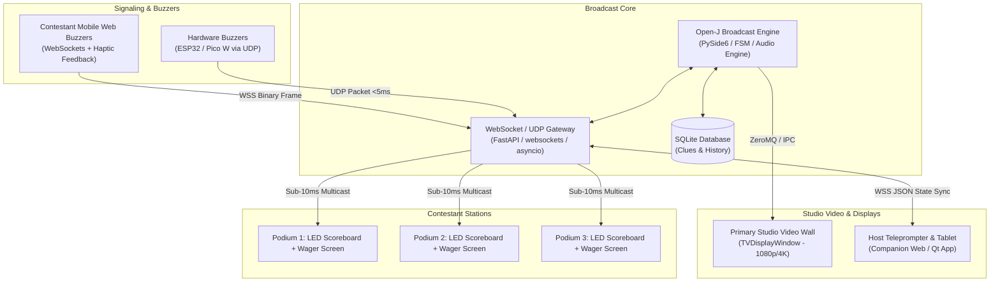

# Project Open-J: Network Protocol & Hardware Integration Architecture Specification

**Author:** Principal Python & PySide6 Software Architect  
**Classification:** Technical Roadmap & Protocol Blueprint  
**Status:** Approved for Implementation  
**Version:** 2.0.0  

---

## 1. System Overview & Distributed Network Topology

Project Open-J is architected to operate both as an isolated studio broadcast workstation and as a distributed, multi-node live television production network. The network topology connects the central broadcast engine with contestant hardware buzzers, mobile clients, contestant podium displays, and the host's companion teleprompter/scoring tablet.



---

## 2. Remote Hardware & Mobile Buzzer Integration Specification

### 2.1. Ultra-Low Latency Protocol Selection
To eliminate unfair networking advantages and accurately enforce the mandatory **0.25-second (250 ms) early ring lockout penalty**, the buzzer subsystem implements a dual-layer transport architecture:

1. **UDP Datagram Channel (Hardware Buzzers)**:
   - Target Latency: $\le 2\text{ ms}$ within local studio LAN / Wi-Fi 6.
   - Used for microcontrollers (ESP32, Raspberry Pi Pico W, Arduino Ethernet).
   - Stateless, lightweight binary datagrams with sequence numbers and hardware monotonic timers.
2. **Secure WebSocket Channel (Mobile Web PWA Buzzers)**:
   - Target Latency: $\le 10\text{ ms}$ over 5GHz Wi-Fi / local intranet.
   - Built on standard RFC 6455 with binary frame packing (`msgpack` or compact JSON).
   - Features client-side screen wake-lock (`navigator.wakeLock.request('screen')`) and haptic feedback (`navigator.vibrate([30])`).

### 2.2. Clock Synchronization & Jitter Compensation
To achieve sub-millisecond fairness across contestant devices, the server and clients establish a continuous clock offset estimation protocol based on a lightweight SNTP (Simple Network Time Protocol) exchange:

$$\theta = \frac{(T_1 - T_0) + (T_2 - T_3)}{2}, \quad \delta = (T_3 - T_0) - (T_2 - T_1)$$

Where:
- $T_0$: Client transmit timestamp
- $T_1$: Server receive timestamp
- $T_2$: Server transmit reply timestamp
- $T_3$: Client receive reply timestamp
- $\theta$: Clock offset
- $\delta$: Round-trip delay (RTT)

Clients adjust their local timestamps using an exponentially weighted moving average (EWMA) of $\theta$.

### 2.3. Buzzer State Machine & Early Ring Lockout Pipeline
The server orchestrates contestant signaling according to the official Jeopardy rules:

```mermaid
sequenceDiagram
    autonumber
    participant Host as Host Controller
    participant Engine as Open-J Core FSM
    participant Coordinator as Buzzer Coordinator
    participant Contestant as Contestant Buzzer (Hardware / PWA)

    Host->>Engine: Clue Selected & Displayed
    Engine->>Coordinator: lock_buzzer()
    Coordinator-->>Contestant: BROADCAST {type: "BUZZER_STATE", state: "LOCKED"}

    Note over Contestant: Contestant rings in while host is reading!
    Contestant->>Coordinator: BUZZ_PACKET {player_id: "p1", ts: 100250}
    Coordinator->>Coordinator: Record early buzz penalty (now + 0.25s)
    Coordinator-->>Contestant: BUZZ_REJECTED {reason: "EARLY_LOCKOUT", penalty_ms: 250}

    Host->>Engine: Clue Reading Finished
    Engine->>Coordinator: unlock_buzzer()
    Coordinator-->>Contestant: BROADCAST {type: "BUZZER_STATE", state: "UNLOCKED"}

    Note over Contestant: Eligible contestants can buzz; P1 locked for 250ms
    Contestant->>Coordinator: BUZZ_PACKET {player_id: "p2", ts: 100500}
    Coordinator->>Coordinator: Accept P2 buzz, start 5s countdown
    Coordinator-->>Host: CONTESTANT_RECOGNIZED {player_id: "p2"}
    Coordinator-->>Contestant: BROADCAST {type: "BUZZER_ACTIVE", recognized_player: "p2"}
```

### 2.4. Binary Datagram Specification (UDP Payload)
Hardware buzzers send a fixed 16-byte binary datagram:

| Offset (Bytes) | Field Name | Data Type | Description |
|---|---|---|---|
| `0x00 - 0x01` | `MAGIC_HEADER` | `uint16` (`0x4A50` - 'JP') | Protocol validation header |
| `0x02` | `PROTOCOL_VERSION`| `uint8` (`0x02`) | Protocol version |
| `0x03` | `PLAYER_ID` | `uint8` (`1, 2, 3`) | Contestant identifier (1 to 3) |
| `0x04 - 0x07` | `SEQUENCE_NO` | `uint32` | Monotonically increasing counter |
| `0x08 - 0x0F` | `DEVICE_TIMESTAMP`| `uint64` | Microseconds since device boot |

---

## 3. Multi-Screen Companion Display Broadcasting Protocol

### 3.1. Display Topology & Responsibilities
Broadcast quiz shows require multiple synchronized displays running at distinct refresh rates and aspect ratios:

1. **Main Stage TV Display (`TVDisplayWindow`)**:
   - 16:9 1080p/4K audience and camera video wall.
   - Renders cosmic waitboard, 64-TV bezel mosaic, 3D card flips, slide zooms, and 15s crimson red transitions.
2. **Host Teleprompter & Scoring Console (`HostControllerWindow` / Companion Tablet)**:
   - Host private display: Clue text, answer guide, phonetic pronunciation, wager approvals, manual score adjustment, and buzzer enable toggles.
3. **Contestant Podium Scoreboards (Companion Units)**:
   - High-contrast numerical LED display facing contestants and studio cameras.
   - Wager input touch interface during Daily Double and Final Jeopardy.

### 3.2. State Synchronization Protocol (Pub-Sub Architecture)
The Central Engine acts as the Single Source of Truth (SSOT). All companion displays subscribe to a publish-subscribe broadcast topic:

```json
{
  "protocol": "OPEN_J_SYNC",
  "version": "2.0.0",
  "timestamp": 1727548800123,
  "match_id": 42,
  "game_phase": "FINAL_JEOPARDY_CLUE",
  "round_id": 3,
  "scores": {
    "player_1": 16400,
    "player_2": 14200,
    "player_3": 8600
  },
  "active_clue": {
    "category": "WORLD LEADERS",
    "points": 0,
    "is_daily_double": false,
    "reading_unlocked": false
  },
  "buzzer_state": {
    "status": "LOCKED",
    "active_player": null,
    "remaining_seconds": 30
  },
  "display_theme": {
    "bg_color": "#800000",
    "is_crimson_shift": true
  }
}
```

### 3.3. Fault Tolerance & Reconnection Policy
- **Heartbeat Interval**: 1,000 ms ping/pong across all WebSocket connections.
- **Failover & Reconnect**: Companion devices automatically reconnect with exponential backoff (100ms, 200ms, 400ms, max 2000ms). Upon reconnection, the client requests a full state snapshot (`STATE_RESYNC_REQUEST`).
- **Offline Safeguard**: The Host Controller retains full local control even if network companion displays experience temporary disconnects.

---

## 4. Hardware Implementation Roadmap

### 4.1. Phase 1: Local PySide6 Simulation (Complete)
- In-process event bus and simulated keyboard/button buzzers.
- Dual-monitor multi-screen orchestration (`app.screens()`).

### 4.2. Phase 2: Microcontroller Hardware Integration
- ESP32-S3 firmware utilizing FreeRTOS tasks:
  - Task 1: Interrupt-driven mechanical switch debounce ($\le 1\text{ ms}$).
  - Task 2: UDP packet transmission with retry buffering.
- RGB Neopixel status ring indicating Locked (Red), Ready (Yellow), and Buzzed In (Green).

### 4.3. Phase 3: Mobile PWA Client
- Standalone HTML5/Vue.js PWA accessible via studio local Wi-Fi QR code (`http://open-j.local:8080/buzzer/1`).
- Low-latency touch event listeners (`touchstart` without 300ms mobile tap delay).
- Screen wake lock to prevent standby during taping.
